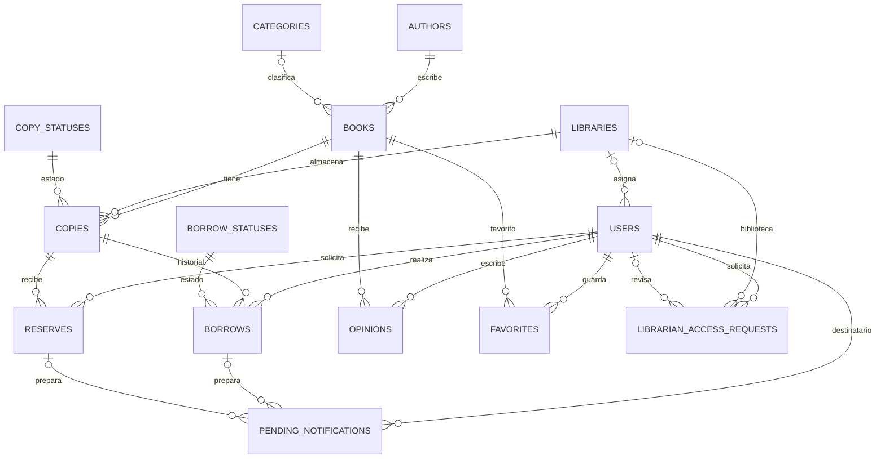

# BibloBook

Aplicación para consultar libros y gestionar bibliotecas, ejemplares, préstamos, reservas, opiniones y favoritos.

## Requisitos

- PHP 8.4 y Composer
- Node.js y npm
- MySQL

## Instalación

```bash
composer install
npm install
copy .env.example .env
php artisan key:generate
```

Configura la conexión a MySQL en `.env` y ejecuta:

```bash
php artisan migrate --seed
npm run build
```

Para ejecutar las pruebas:

```bash
php artisan test --compact
```

## Datos principales

- Un libro puede tener varios ejemplares.
- Cada ejemplar pertenece a una biblioteca.
- Los préstamos guardan la fecha de inicio, vencimiento y devolución.
- Sus estados son `Active`, `Returned` y `Overdue`; son distintos de los estados de los ejemplares.
- Los préstamos de demostración se crean con fechas relativas al momento de la siembra: inicio hace siete días y vencimiento quince días después del inicio. Así, el vencimiento queda siempre ocho días en el futuro.
- El programador de Laravel marca a diario los préstamos vencidos.
- Las reservas duran 24 horas.
- Las opiniones aceptan puntuaciones del 1 al 5.

## Cierre y avisos de préstamos

Estos comandos preparan resúmenes o avisos y escriben el detalle en el canal de log de Laravel (por defecto, `storage/logs/laravel.log`). No envían correo ni notifican directamente a los usuarios.

```bash
php artisan borrows:daily-closing
php artisan borrows:daily-closing --date=2026-11-25
php artisan borrows:notify-overdue
php artisan borrows:notify-overdue 12
php artisan reserves:notify-holders
php artisan reserves:notify-holders 7
```

La salida de consola confirma el número de registros preparados, por ejemplo `Logged 1 overdue loan notification(s).`; el cierre muestra sus totales (`issued`, `returned` y `overdue`). Los cambios de estado crean a la vez un registro `pending` en `pending_notifications`. Si falla el comando posterior, la intención queda guardada para que una integración futura pueda reintentarlo; esta entrega todavía no incluye un procesador ni envío de correo.



Los datos principales son:

- **Libro:** título, autor, editorial, fecha de publicación, edición, ISBN y categoría.
- **Ejemplar:** libro, biblioteca, código de barras y estado.
- **Préstamo:** usuario, ejemplar, inicio, vencimiento, devolución y estado. No se pueden borrar usuarios o ejemplares con historial de préstamos.
- **Reserva:** usuario, ejemplar, inicio y vencimiento.
- **Opinión:** usuario, libro, puntuación del 1 al 5 y comentario opcional.

## Ejemplo bibliográfico

| Dato | Ejemplo |
|---|---|
| Título | The Hobbit |
| Autor | J. R. R. Tolkien |
| Editorial | HarperCollins |
| Fecha de publicación | 2001-09-01 |
| Edición | Paperback |
| ISBN-13 | 9780007118359 |
